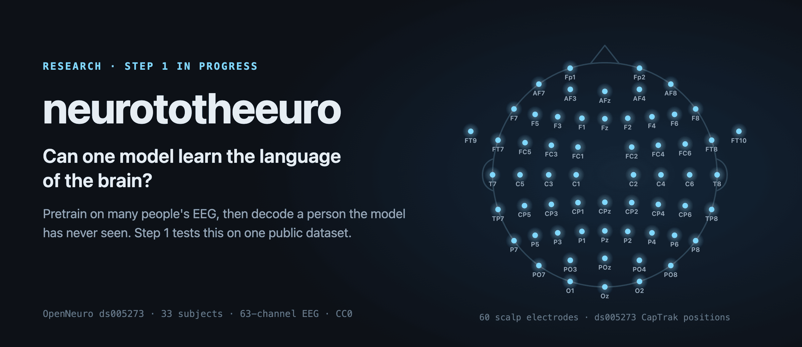
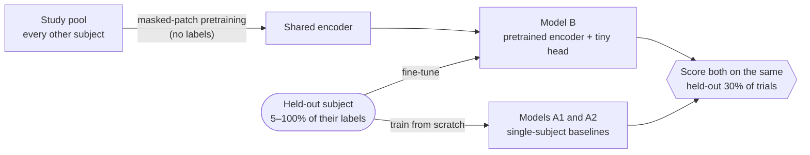
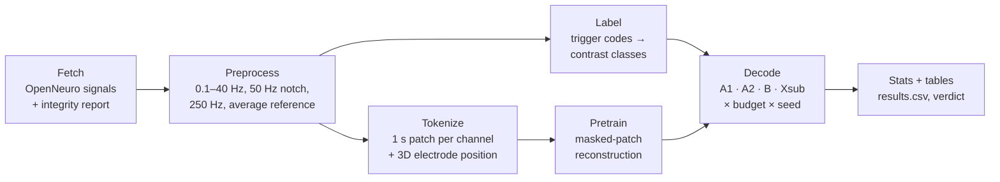
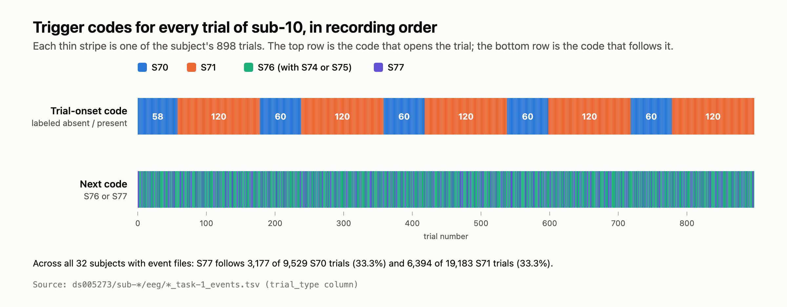
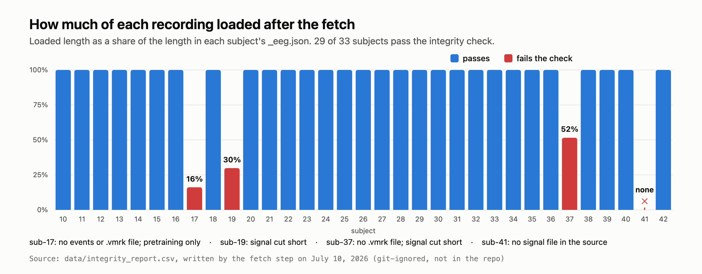

<p align="center">
  
</p>

<p align="center">
  <b>Can one self-supervised model learn the "language" of brain activity well enough to decode a person it has never seen?</b><br>
  This repo holds Step 1: a pre-registered test on public EEG of whether pretraining on many people helps decode a new one.
</p>

<p align="center">
  
  
  
  
  
  
</p>

<p align="center">
  <a href="#why">Why</a> ·
  <a href="#the-step-1-experiment">Experiment</a> ·
  <a href="#how-the-pipeline-works">Pipeline</a> ·
  <a href="#the-data">Data</a> ·
  <a href="#results-so-far">Results</a> ·
  <a href="#run-it">Run it</a> ·
  <a href="#known-limitations">Limitations</a>
</p>

> [!IMPORTANT]
> This is early research. The pipeline is built and runs end to end on synthetic data, but it has not produced a result on real EEG yet. The trigger codes the main label depends on also need a second look before the full run; see [The presence label needs a second look](#the-presence-label-needs-a-second-look).

## Why

Large language models learned the patterns of language by reading a huge pile of text, with no grammar rules written in. That is why they handle sentences they have never seen. This project asks whether the same recipe works for brain signals: pretrain one model on a large pile of neural recordings, without labels, and see whether it learns patterns that carry over to new brains.

Today, a brain decoder is usually trained from scratch for each new person, because every brain and every recording session differs. That per-person training is slow and expensive, and it is a main reason brain-reading systems don't scale. If a model that has studied many brains arrives at your brain already mostly fluent, that step shrinks or goes away. If it doesn't, brains may be too individual for one shared model.

> **Research question.** Can a single self-supervised model, pretrained on large multi-subject neural recordings, learn a transferable representation of neural dynamics that decodes new brains and new tasks with little or no retraining?

## The Step 1 experiment

Step 1 is a cheap, public-data check of the core idea before anything bigger: does a model that studied *many* people's EEG decode a *new* person better, and with less of that person's labeled data, than a model that only saw that one person?



Each subject takes a turn as the held-out subject (rotating leave-one-subject-out), with 5 seeds per setting.

| Model | What it is |
|---|---|
| `A1_matched` | The same transformer and head as Model B, trained from scratch on the held-out subject only |
| `A2_eegnet` | EEGNet, a widely used compact EEG network, trained on the held-out subject only |
| `B_ssl` | An encoder pretrained on the study pool with masked-patch reconstruction, then fine-tuned with the held-out subject's labels. A frozen-encoder linear probe is also scored. |
| `Xsub_sup` | Trained with labels on the study pool, then lightly fine-tuned on the held-out subject. A sanity anchor. |

**The headline result is a data-efficiency curve:** how little of a new subject's labeled data Model B needs to match the baselines, swept over 5, 10, 25, 50, and 100% of that subject's training trials. Pretraining breadth (a study pool of 1, 4, 14, or 28 subjects) is a secondary ablation.

**One test is pre-registered as confirmatory**, fixed in [`configs/spec_v1.yaml`](configs/spec_v1.yaml) before any real data ran: a one-sided Wilcoxon signed-rank test across held-out subjects of `B_ssl` (fine-tuned) against `A2_eegnet`, on balanced accuracy, for the `presence` contrast at a 25% label budget, with α = 0.05. Every other comparison is exploratory, with Holm correction across budgets.

A "B wins" here would show that cross-subject pretraining helps on this one dataset. It would not show that a general brain foundation model works.

## How the pipeline works



1. **Preprocess.** The 63-channel, 1000 Hz BrainVision recordings are band-passed at 0.1–40 Hz, notched at 50 Hz (a European rig), resampled to 250 Hz, and re-referenced to the average of the 60 scalp channels. EOG1, EOG2, and the flat online reference FCz have no electrode coordinates and are dropped. Trials are cut from −0.2 s to 1.0 s around the trial-onset code.
2. **Label.** Labels come from the `trial_type` string (`Stimulus/S NN`), never from the `value` column, which is renumbered per file and doesn't match across subjects. [`src/n2e/data/codebook.py`](src/n2e/data/codebook.py) defines two contrasts: `presence` (S70 against S71) and `seen_unseen` (marked provisional).
3. **Tokenize.** Each channel's signal is cut into 1 s patches. Every patch gets a linear embedding plus its electrode's 3D position, encoded with Fourier features, so the model knows where on the head each signal came from.
4. **Pretrain.** A 6-layer transformer (256 dimensions, 8 heads) learns by reconstructing randomly masked patches: half the patches are hidden, and the loss is the error on those patches.
5. **Decode and test.** A tiny head, identical across A1 and B, reads the pooled encoder output. Every run appends rows to one `results.csv` with a fixed schema, and every table and verdict is a reduction of that file.

Every number the code uses lives in [`configs/spec_v1.yaml`](configs/spec_v1.yaml). [`configs/smoke.yaml`](configs/smoke.yaml) shrinks it for a fast synthetic run, and [`configs/spec_v1_patch0p5.yaml`](configs/spec_v1_patch0p5.yaml) is the pre-registered 0.5 s patch-length check.

## The data

**[ds005273](https://doi.org/10.18112/openneuro.ds005273.v1.0.0)**, "Neural representation of consciously seen and unseen information" (Rodríguez-San Esteban, Chica, and González-López; CC0). It has 33 subjects doing the same visual task on the same Brain Products rig: 63 EEG channels at 1000 Hz, and roughly 90 to 120 minutes of recording per subject. Many subjects on one task and one rig makes it a clean first test of cross-subject transfer. The paper behind it is Rodríguez-San Esteban et al., *Scientific Reports* 2025 ([PMC11885812](https://pmc.ncbi.nlm.nih.gov/articles/PMC11885812/)).

This repo tracks only the dataset's BIDS metadata: events, channels, electrode positions, and sidecar JSON. The signal files are fetched from OpenNeuro on demand and are git-ignored.

### The presence label needs a second look

`codebook.py` labels S71 as "target present" and S70 as "target absent", because each subject has about 600 S71 trials and 300 S70 trials, which matches the paper's 2:1 present-to-absent ratio. The event files in this repo point to a different reading.

<p align="center">
  
</p>

<sub>Computed from the `trial_type` column of every `ds005273/sub-*/eeg/*_task-1_events.tsv` in this repo.</sub>

- **S70 and S71 never mix inside a block.** Each session alternates blocks of about 60 S70 trials with blocks of about 120 S71 trials: five cycles in 31 of the 32 subjects with event files, and four in sub-27.
- **The 2:1 split shows up inside every block.** In each of the 318 blocks, one trial in three carries S77 (within 2 percentage points), and the rest carry S76 with S74 or S75. S70 blocks and S71 blocks look the same.
- **The S71 count matches the experimental trial count.** The codebook notes from the paper describe 600 experimental trials plus localizer blocks, and most subjects have exactly 600 S71 trials.

If S70 and S71 mark the block type, the current `presence` contrast learns which block a trial came from, not whether a target appeared. S76 against S77 looks like a likelier presence label. Confirming this against the authors' stimulus script, which the codebook already calls for to settle `seen_unseen`, should come before the full grid runs.

### Data check

<p align="center">
  
</p>

<sub>From the integrity report the fetch step wrote on July 10, 2026 (`data/integrity_report.csv`, git-ignored). Expected lengths come from each subject's `_eeg.json`.</sub>

The fetch step loads every signal with MNE and checks channel count, sampling rate, length, and events. In the July run, 29 of 33 subjects passed. sub-17 has no events file, so it is used only for pretraining. sub-19 and sub-37 are shorter than their metadata says, and sub-41 has no signal file in the source.

**ds005648**, "Mapping object space dimensions: new insights from temporal dynamics" (Kidder, Quek, and Grootswagers; CC0; [DOI](https://doi.org/10.18112/openneuro.ds005648.v1.0.3)), is also staged as metadata. It is out of scope for Step 1. If Step 1 shows a benefit, the planned next pretraining datasets are THINGS-EEG1 (ds003825) and then HBN-EEG (ds005505–ds005516) for scale.

## Results so far

**There is no real-data result yet.** The one committed run is the synthetic smoke test in [`results/smoke/`](results/smoke/). It runs every stage on 4 generated subjects that copy the real 63-channel layout and trigger structure, and it checks that the pipeline writes `results.csv`, `TABLES.md`, `T1`–`T4`, `verdict.txt`, and `primary_test.json` in the right shape.

On that synthetic data, Model B does not beat EEGNet (median change in balanced accuracy −0.486 at the 25% budget). That is expected: the synthetic signal is noise plus one evoked response whose sign flips with the label, so pretraining on it has nothing general to learn, while EEGNet fits the response directly. The numbers say nothing about real brains.

`pytest` runs 21 tests in [`tests/`](tests/): trigger-code parsing against real event files, fetch and integrity logic, split construction, and the statistics.

## Run it

You need Python 3.12 (`pyproject.toml` allows 3.10 and later; the run guide uses 3.12 for PyTorch and MNE) and, for real data, [git-annex](https://git-annex.branchable.com/).

```sh
python3.12 -m venv .venv
.venv/bin/pip install -U pip
.venv/bin/pip install -e ".[dev]"
```

To check the plumbing without fetching any EEG, run the tests and the synthetic smoke run. The smoke run takes seconds to minutes on a CPU.

```sh
.venv/bin/python -m pytest tests/ -q
.venv/bin/python scripts/run_experiment.py --config configs/smoke.yaml \
    --source synthetic --n-synth-subjects 4 --out results/smoke
```

To run on real data, fetch the signals first. Each subject's signal is about 1.5 GB, so plan for roughly 44 GB for all 33.

```sh
.venv/bin/python scripts/fetch_data.py --dest data/ds005273 --subjects sub-{10..42}
```

The script writes its integrity report to `results/ds005273_integrity.csv` (change it with `--report`). If any subject fails the check, the script still writes the report but exits with an error; add `--allow-integrity-failures` to exit cleanly.

Then run the grid. sub-17 has no events, so it joins pretraining only, and sub-41 has no signal, so it is left out. sub-19 and sub-37 load short; decide whether to keep them before a full run.

```sh
SUBJECTS=(sub-{10..16} sub-{18..40} sub-42)
.venv/bin/python scripts/run_experiment.py --config configs/spec_v1.yaml --source real \
    --bids-root data/ds005273 --decodable "${SUBJECTS[@]}" --ssl-only sub-17 \
    --out results/ds005273_presence --device cpu
```

To recompute the statistics and tables from an existing `results.csv` without retraining, run `scripts/analyze.py --results <path to results.csv> --config configs/spec_v1.yaml`.

[`README_PIPELINE.md`](README_PIPELINE.md) is the full run guide, and [`EXPERIMENT_BRIEF.md`](EXPERIMENT_BRIEF.md) is the task spec the pipeline was built from.

## Known limitations

- **No real-data result.** Only the synthetic smoke run exists.
- **The `presence` label may be a block label.** See [The presence label needs a second look](#the-presence-label-needs-a-second-look). `seen_unseen` is also unconfirmed and carries a `provisional` flag on every result.
- **Memory.** `run_grid` stacks every study-pool crop in RAM. That works for the smoke run but needs tens of GB for 32 subjects; the full grid needs a streaming crop loader first.
- **Pretraining target.** Version 1 reconstructs raw voltages, which is hard on noisy EEG. Predicting in a learned latent space is the planned version 2.
- **Data gaps.** sub-17, sub-19, sub-37, and sub-41 fail the integrity check (see [Data check](#data-check)).
- **One dataset.** Step 1 tests one task on one rig. A positive result would not generalize on its own.

## Why EEG

EEG is not the sharpest brain signal. Implanted electrodes and MEG are much cleaner, but they need surgery or a shielded room that costs millions, so they can't scale. EEG is cheap, wearable, and available in large free datasets: [OpenNeuro](https://openneuro.org/) alone hosts tens of thousands of EEG participants. If the idea works on noisy EEG, that is the strongest sign it could work outside a lab.

<details>
<summary>Long-term framing</summary>

| Level | What it means here |
|---|---|
| **Background knowledge** | Large standardized brain datasets now exist, and the language-model self-supervised recipe showed that you can learn general patterns from raw sequences. The pieces exist; nobody has assembled the general model. |
| **Research question** | Does a pretrained brain foundation model transfer to new brains with little or no retraining? |
| **Scalable product** | A pretrained neural foundation model and API that denoises, aligns, and decodes brain data out of the box for labs, pharma, and brain-computer interface companies. |
| **A startup?** | A research lab that ships models, in the style of TRIBE or ESM: publish the science, and offer the pretrained weights and decoding layer. |

All of this depends on Step 1 and the steps after it working.

</details>

<details>
<summary>Background notes on computational neuroscience</summary>

**Areas of study**

- **Single-cell modeling:** simulating the electrical and chemical behavior of individual neurons.
- **Network dynamics:** modeling large neuron populations to see how memory, perception, and brain rhythms arise.
- **Cognitive computation:** using top-down algorithms, such as reinforcement learning and Bayesian inference, to reverse-engineer cognition and behavior.
- **Synaptic plasticity:** modeling how connections strengthen or weaken over time to support learning and memory.
- **Neural decoding:** reconstructing what someone sees, hears, or intends from brain activity.
- **Neuromorphic engineering:** chips that physically mimic the brain's architecture.
- **Brain-computer interfaces:** direct pathways between brain signals and external devices, such as robotic limbs or computers.
- **Large-scale brain simulations:** multi-million-neuron models of whole brain regions, such as the neocortex.

**Core methods**

- **Dynamical systems:** how neural states change over time, for example in associative memory and decision-making.
- **Information theory:** how the nervous system encodes, processes, and transmits information.
- **Machine learning:** artificial neural networks used to test hypotheses about learning and perception.
- **Statistical mechanics:** how large-scale brain states, such as sleep and attention, emerge from millions of neurons.
- **Graph theory:** the brain as a network of nodes and edges, for mapping connectivity and information flow.
- **Biophysical simulation:** tools such as NEURON and Brian2 that simulate ion channels and receptors.
- **Dimensionality reduction:** PCA and t-SNE to compress large multi-neuron datasets into patterns you can interpret.
- **Voltage clamp:** a foundational technique for measuring the ionic currents behind a neuron's electrical activity.

</details>

## References

- [OpenNeuro](https://openneuro.org/), the open brain-data archive this project draws on.
- [Meta Brain2Qwerty](https://facebookresearch.github.io/brain2qwerty/): decoding typed sentences from non-invasive brain signals.
- [Meta TRIBE v2](https://ai.meta.com/blog/tribe-v2-brain-predictive-foundation-model/): a brain-predictive foundation model trained much like a language model.

## Credits

Noel Sason wrote the Step 1 pipeline and the project framing. shaunisrani added the ds005648 dataset. The ds005273 data comes from Pablo Rodríguez-San Esteban, Ana B. Chica, and José A. González-López, and ds005648 from Alexis Kidder, Genevieve Quek, and Tijl Grootswagers, both under CC0.
